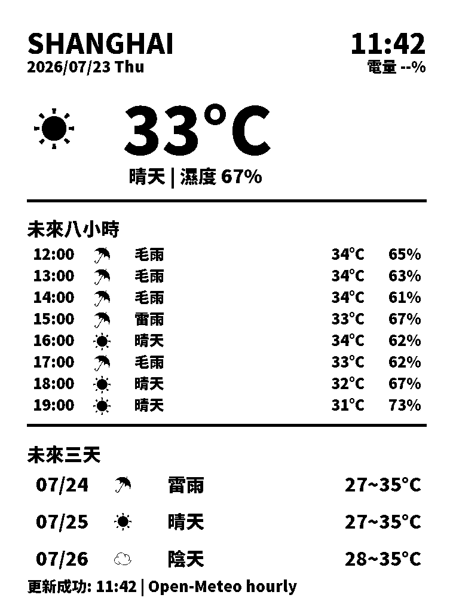
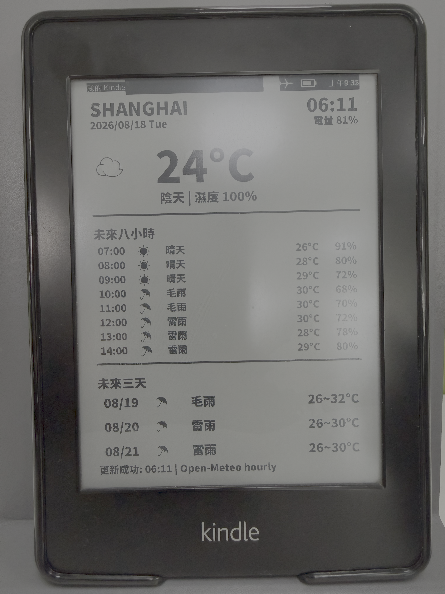

# Kindle PW1 Weather Station

<p align="center">
  <a href="#繁體中文"><strong>繁體中文</strong></a>
  ·
  <a href="#中文"><strong>简体中文</strong></a>
  ·
  <a href="#english"><strong>English</strong></a>
</p>

---

## 繁體中文

<p align="center">
  <strong>繁體中文</strong>
  ·
  <a href="#中文">简体中文</a>
  ·
  <a href="#english">English</a>
</p>

Kindle Paperwhite 1 天氣站擴充套件。它會把上海天氣、未來 8 小時逐小時預報、未來 3 天天氣預報渲染成灰階 `weather.png`，並顯示在 Kindle E Ink 螢幕上。

### PNG 範例圖




### KUAL 選單範例

```text
Weather Clock
├─ Update Once
├─ Enable RTC（啟用省電排程）
└─ Disable schedule（停用排程）
```

### 功能

- 目前天氣、溫度、濕度、日期、時間與電池百分比
- 未來 8 小時逐小時顯示，並顯示未來 3 天天氣
- 可在 `config.xml` 選擇中文或英文顯示
- 使用 Open-Meteo 小時預報，不需要 API key
- 只在更新時開啟 Wi-Fi，完成後自動關閉
- 自動更新使用 Online Screensaver 的 RTC 喚醒，等待期間允許休眠
- `worker.sh` 永遠只做單次更新，跑完就恢復省電狀態並退出
- 週一至週五 08:00、11:00、14:00、17:00、20:00 自動更新，週末不更新

### 更新模式

- `weatheriot` 模式：在 Kindle 本機執行 `weatheriot/worker.sh`，產生 `weather.png` 後顯示；不需要圖片伺服器。
- Online Screensaver 模式：由 `onlinescreensaver/bin/config.sh` 的 `IMAGE_URI` 從 URL 下載 PNG，並交由 `linkss` 顯示。
- `IMAGE_URI=""` 時使用本機 `weatheriot` 產圖；自動排程統一由 Online Screensaver 管理，兩個 KUAL 選單的排程按鈕是同一套功能。

### 檔案

- `weatheriot/` - Kindle 擴充套件檔案，包含腳本、設定、字型與預覽圖片

### 安裝

1. 將 `weatheriot/` 與 `onlinescreensaver/` 分別複製到 Kindle 的 `/mnt/us/extensions/`，保留目錄名稱：

   ```text
   /mnt/us/extensions/weatheriot
   /mnt/us/extensions/onlinescreensaver
   ```

2. 修改 `weatheriot/config.xml`：

   ```xml
   <city>Shanghai</city>
   <lat>31.2304</lat>
   <lon>121.4737</lon>
   <lang>zh</lang>
   ```

   `lang` 控制圖片顯示語言：

   - `zh` - 中文
   - `en` - 英文

3. 在 KUAL 開啟 `Weather Clock`，選擇：

   - `Update Once` - 立即更新一次
   - `Enable RTC`（啟用省電排程）- 啟用每日五次排程，並自動清除舊四小時排程
   - `Disable schedule`（停用排程）- 停止自動更新，包含清除舊排程

   Online-Screensaver 的同名按鈕功能相同。只需在其中一個選單啟用一次；重新開啟 KUAL 後才會載入更新的選單。

### 需求

- 已越獄 Kindle Paperwhite 1
- KUAL
- Kindle 上的 Python 3
- Python packages: `requests`, `Pillow`
- 不需要天氣 API key

### 注意事項

- `weather.png` 是預覽用產生圖片；Kindle 實際執行時會覆蓋它。
- 將 `weatheriot/` 目錄內的檔案下載到 Kindle 的 `/mnt/us/extensions/weatheriot`；`weather.png` 可選，只是首次顯示前的預覽圖。
- `weather.tmp.png`、`log.txt`、`schedule.pid` 與執行診斷檔案應留在本機，不提交到 GitHub。
- `worker.sh` 每次更新後關閉 Wi-Fi；Online Screensaver 會接管休眠與下一次 RTC 喚醒，啟用設定會隨開機載入。
- 舊 `weatheriot/schedule.sh` 僅保留相容性，不再提供 KUAL 啟用入口；手動執行它仍會使用較耗電的常醒模式。
- 請保留 `onlinescreensaver/bin/scheduler.sh`，它是目前使用的 RTC 排程程式。

---

## 中文

<p align="center">
  <a href="#繁體中文">繁體中文</a>
  ·
  <strong>简体中文</strong>
  ·
  <a href="#english">English</a>
</p>

Kindle Paperwhite 1 天气站扩展。它会把上海天气、未来 8 小时逐小时预报、未来 3 天预报渲染成灰阶 `weather.png`，并显示在 Kindle E Ink 屏幕上。

### PNG 样例图


### KUAL 菜单样例

```text
Weather Clock
├─ Update Once
├─ Enable RTC（启用省电定时）
└─ Disable schedule（停用定时）
```

### 功能

- 当前天气、温度、湿度、日期、时间与电池百分比
- 未来 8 小时逐小时显示，并显示未来 3 天天气
- 可在 `config.xml` 选择中文或英文显示
- 使用 Open-Meteo 小时预报，不需要 API key
- 只在更新时开启 Wi-Fi，完成后自动关闭
- 自动更新使用 Online Screensaver 的 RTC 唤醒，等待期间允许休眠
- `worker.sh` 永远只做单次更新，跑完就恢复省电状态并退出
- 周一至周五 08:00、11:00、14:00、17:00、20:00 自动更新，周末不更新

### 更新模式

- `weatheriot` 模式：在 Kindle 本机执行 `weatheriot/worker.sh`，生成 `weather.png` 后显示；不需要图片服务器。
- Online Screensaver 模式：由 `onlinescreensaver/bin/config.sh` 的 `IMAGE_URI` 从 URL 下载 PNG，并交由 `linkss` 显示。
- `IMAGE_URI=""` 时使用本机 `weatheriot` 生成图片；自动定时统一由 Online Screensaver 管理，两个 KUAL 菜单的定时按钮是同一套功能。

### 文件

- `weatheriot/` - Kindle 扩展文件，包含脚本、配置、字体与预览图片

### 安装

1. 将 `weatheriot/` 与 `onlinescreensaver/` 分别复制到 Kindle 的 `/mnt/us/extensions/`，保留目录名称：

   ```text
   /mnt/us/extensions/weatheriot
   /mnt/us/extensions/onlinescreensaver
   ```

2. 修改 `weatheriot/config.xml`：

   ```xml
   <city>Shanghai</city>
   <lat>31.2304</lat>
   <lon>121.4737</lon>
   <lang>zh</lang>
   ```

   `lang` 控制图片显示语言：

   - `zh` - 中文
   - `en` - 英文

3. 在 KUAL 打开 `Weather Clock`，选择：

   - `Update Once` - 立即更新一次
   - `Enable RTC`（启用省电定时）- 启用每日五次定时，并自动清除旧四小时定时
   - `Disable schedule`（停用定时）- 停止自动更新，包括清除旧定时

   Online-Screensaver 的同名按钮功能相同。只需在其中一个菜单启用一次；重新打开 KUAL 后才会加载更新的菜单。

### 需求

- 已越狱 Kindle Paperwhite 1
- KUAL
- Kindle 上的 Python 3
- Python packages: `requests`, `Pillow`
- 不需要天气 API key

### 注意事项

- `weather.png` 是预览用生成图片；Kindle 实际运行时会覆盖它。
- 将 `weatheriot/` 目录内的文件下载到 Kindle 的 `/mnt/us/extensions/weatheriot`；`weather.png` 可选，只是首次显示前的预览图。
- `weather.tmp.png`、`log.txt`、`schedule.pid` 与运行诊断文件应留在本机，不提交到 GitHub。
- `worker.sh` 每次更新后关闭 Wi-Fi；Online Screensaver 会接管休眠与下一次 RTC 唤醒，启用设置会随开机加载。
- 旧 `weatheriot/schedule.sh` 仅保留兼容性，不再提供 KUAL 启用入口；手动执行它仍会使用较耗电的常醒模式。
- 请保留 `onlinescreensaver/bin/scheduler.sh`，它是目前使用的 RTC 定时程序。

---

## English

<p align="center">
  <a href="#繁體中文">繁體中文</a>
  ·
  <a href="#中文">简体中文</a>
  ·
  <strong>English</strong>
</p>

Kindle Paperwhite 1 weather station extension. It renders Shanghai weather, the next 8 hourly forecasts, and the next 3 days to a grayscale `weather.png`, then displays it on the Kindle E Ink screen.

### PNG Sample


### KUAL Menu Sample

```text
Weather Clock
├─ Update Once
├─ Enable RTC (power-saving schedule)
└─ Disable schedule
```

### Features

- Current weather, temperature, humidity, date, time, and battery percentage
- Next 8 hours with one row per hour, plus next 3 days
- Chinese or English display selected from `config.xml`
- Open-Meteo hourly forecast, no API key required
- Wi-Fi turns on only during refresh, then turns off again
- Automatic updates use Online Screensaver RTC wakeups and allow sleep between updates
- `worker.sh` always runs a single refresh, restores Kindle power-saving state, then exits
- Automatic refreshes run at 08:00, 11:00, 14:00, 17:00, and 20:00, Monday through Friday; weekends are skipped

### Update modes

- `weatheriot` mode: runs `weatheriot/worker.sh` on the Kindle, generates `weather.png`, and displays it locally; no image server is required.
- Online Screensaver mode: downloads a PNG URL configured as `IMAGE_URI` in `onlinescreensaver/bin/config.sh`, then displays it through `linkss`.
- When `IMAGE_URI=""`, local `weatheriot` rendering is selected. Online Screensaver manages all automatic scheduling; the schedule buttons in both KUAL menus control the same service.

### Files

- `weatheriot/` - Kindle extension files, including scripts, configuration, font, and preview images

### Setup

1. Copy both `weatheriot/` and `onlinescreensaver/` into `/mnt/us/extensions/` on Kindle, preserving their directory names:

   ```text
   /mnt/us/extensions/weatheriot
   /mnt/us/extensions/onlinescreensaver
   ```

2. Edit `weatheriot/config.xml`:

   ```xml
   <city>Shanghai</city>
   <lat>31.2304</lat>
   <lon>121.4737</lon>
   <lang>zh</lang>
   ```

   `lang` controls the rendered display language:

   - `zh` - Chinese
   - `en` - English

3. From KUAL, open `Weather Clock` and choose:

   - `Update Once` - refresh immediately
   - `Enable RTC` - enable five weekday refreshes and automatically remove the legacy four-hour schedule
   - `Disable schedule` - stop automatic refreshes, including the legacy schedule

   The matching Online-Screensaver buttons perform the same actions. Enable the schedule from either menu once. Close and reopen KUAL to reload updated menu entries.

### Requirements

- Jailbroken Kindle Paperwhite 1
- KUAL
- Python 3 on Kindle
- Python packages: `requests`, `Pillow`
- No weather API key is required

### Notes

- `weather.png` is included as a generated preview image. Runtime updates will overwrite it on Kindle.
- Download the files inside `weatheriot/` to `/mnt/us/extensions/weatheriot` on Kindle; `weather.png` is optional and only provides a preview before the first refresh.
- `weather.tmp.png`, `log.txt`, `schedule.pid`, and runtime diagnostics should stay local.
- `worker.sh` turns Wi-Fi off after each update. Online Screensaver manages sleep and the next RTC wakeup; enabling the service also enables startup at boot.
- Legacy `weatheriot/schedule.sh` remains for compatibility but is no longer exposed in KUAL. Running it manually still uses the more power-hungry always-awake mode.
- Keep `onlinescreensaver/bin/scheduler.sh`; it is the current RTC scheduler.
